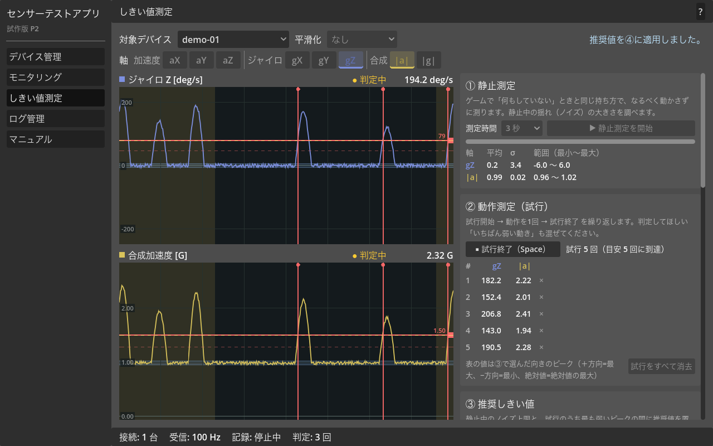
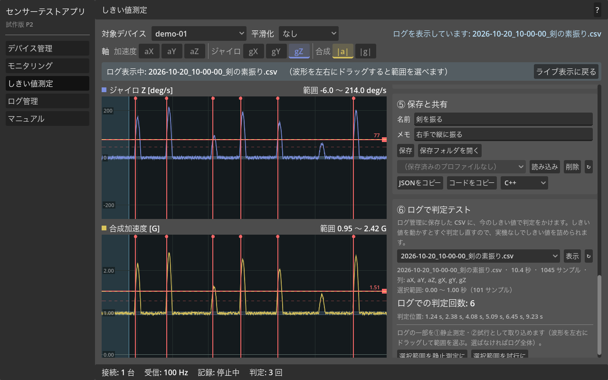
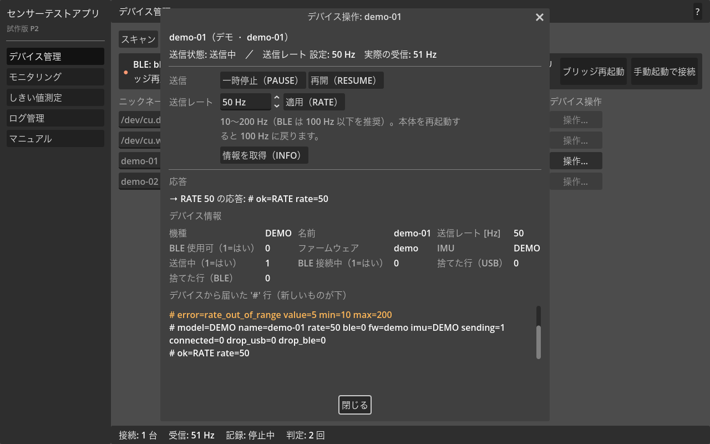

# P2 開発報告書：しきい値測定・BLE接続・軸指定計測

- 期間: 2026-10-20 〜 2026-10-21（夜間の連続作業）
- 体制: リード（統合・設計・レビュー）＋ チーム6名（A〜F、Claude のサブエージェント）
- 成果: 統合PR [#11](https://github.com/shiruku-shibata/Sencer-Test-App/pull/11)（`integration/p2` → `main`、**レビュー待ち・未マージ**）

---

## 1. 結論

依頼内容（センサーのしきい値を測定できるアプリ、M5製品対応、有線/BLE接続、指定軸だけでの計測、共有可能な形）は**すべて実装し、実機なしで確認できる範囲のテストはすべて通過**しています。

ただし **M5 実機での動作確認は一度もできていません**（この環境に実機を接続して試す手段がなかったため）。ファームウェアのビルド・単体テスト、疑似デバイスを使ったアプリ⇔BLEブリッジの結合テストまでは実施済みです。実機での確認手順は [docs/HARDWARE_TEST.md](HARDWARE_TEST.md) にまとめてあります。

## 2. 依頼内容と対応

| 依頼 | 対応 | 主な場所 |
|---|---|---|
| センサーのしきい値を測定できるアプリ | 「しきい値測定」画面：①静止測定 → ②動作の試行 → ③推奨しきい値と判定品質 → ④判定テスト → ⑤保存・共有 → ⑥ログで判定テスト | `src/ui/screens/threshold_screen.gd`, `src/core/threshold_*.gd` |
| 対象は M5StickC Plus2 などの M5 製品 | ファームウェアを 7 機種対応（StickC Plus2 / Plus / 初代、Core2、CoreS3、AtomS3、ATOM Matrix） | `firmware/m5stick_sender/` |
| 接続は有線 or BLE | 有線：macOS/Linux は OS 標準コマンド、Windows はブリッジ経由（pyserial）。BLE：Python(bleak) のブリッジ経由 | `src/core/*_provider.gd`, `tools/ble_bridge/` |
| IMU は指定した軸だけで計測 | 8軸（加速度 XYZ・ジャイロ XYZ・合成加速度・合成角速度）から選択。表示・測定・判定・CSV記録すべてが選択軸だけで動く | `src/core/sensor_axis.gd`, `src/ui/widgets/axis_selector.gd` |
| 4人くらいのチーム | 担当 A〜D の4人で開始し、後半に E（UI追加）と F（外部レビュー）を追加 | 本書 3 章 |
| 共有可能な形式 | GitHub に PR として公開。しきい値は JSON プロファイルで保存・コピーでき、ゲーム側に貼れる C++ / GDScript / C# の判定コードも出力。Windows / Linux の書き出し設定を追加 | `docs/`, `ThresholdProfile` |
| テスト・レビューの繰り返し | 3回のレビュー（相互レビュー×2、外部レビュー×1）と修正を実施（本書 5 章） | 各PRのコメント |
| 後から参加した人向けの説明 | 全PRに「後から参加した人へ」の節。README・設計書・各フォルダの README・アプリ内マニュアル | README.md ほか |

## 3. 体制と進め方

### 3.1 担当

| 担当 | 役割 | 主な成果 |
|---|---|---|
| リード | 設計・インターフェース契約・統合・README・報告 | 設計書、`SensorAxis`、統合ブランチ、README |
| A ファームウェア | M5 複数機種対応、BLE送信、コマンド受付 | ファーム v2.0.0、実機検証チェックリスト |
| B 接続 | BLEブリッジ、BLE/有線 Provider、デバイス管理画面 | ブリッジ v1.1.0（BLE＋シリアル）、`BleSensorProvider`、`BridgeSerialSensorProvider` |
| C しきい値ロジック | 解析・判定・プロファイル・軸指定ログ・テスト基盤 | `ThresholdAnalyzer/Detector/Rule/Profile`、テスト基盤、生成コードの等価性チェック |
| D UI | しきい値測定画面、軸選択、波形、マニュアル | 測定画面、ログで判定テスト、波形ウィジェット |
| E UI追加（途中参加） | デバイス操作UI | PAUSE/RESUME/RATE/INFO の送信と応答表示 |
| F 外部レビュー（途中参加） | 経緯を知らない立場での通しレビューと修正 | PR #11 レビュー、指摘の修正 |

### 3.2 進め方

1. **設計と契約を先に固定**（PR #1）。担当ごとに「所有ファイル」を決め、クラスのシグネチャを契約として文書化。4人が同時に作業しても衝突しないようにした。
2. **並行開発**：各担当が独立した git worktree・ブランチで作業し、PR を作成（#2〜#5）。UI 担当は、ロジック担当の完成前は契約どおりのスタブで画面を作り、完成後に本物へ差し替えた。
3. **統合**：リードが `integration/p2` に順次マージし、全テストを毎回実行。
4. **レビューと修正のループ**（5章）→ フォローアップPR（#6〜#10, #12〜#14）。
5. **報告**：本書と統合PR #11。

### 3.3 Git / PR の運用

- `main` には P1 のベースラインだけが入っています。P2 はすべて `integration/p2` にあり、**統合PR #11 をマージすれば P2 が丸ごと入ります**。
- 個別PR #1〜#5 は main 向けで、レビュー単位として残しています（#11 のマージ後、GitHub が自動でマージ済みにします）。
- #6 以降は `integration/p2` 向けのフォローアップです。リードがローカルで統合ブランチに取り込んで push したため、GitHub 上は「MERGED」表示になっていますが、**main には入っていません**。
- PR の main へのマージはレビューなしでは行わない方針にしました（自動マージは権限で止められたため、最終判断はあなたに委ねています）。

## 4. 成果物

### 4.1 アプリ（Godot 4.4 系）

| 画面 | 内容 |
|---|---|
| デバイス管理 | 有線 / BLE / デモ のスキャン・接続、ニックネーム、RSSI、BLEブリッジの状態と対処、**デバイス操作**（一時停止・送信レート・情報取得） |
| モニタリング | 選択軸だけの波形・数値表示、選択軸だけのCSV記録 |
| **しきい値測定** | ①静止測定（ノイズ） ②試行（Spaceキーで開始/終了） ③推奨値と品質（good/tight/overlap/insufficient） ④判定テスト（しきい値線をドラッグで調整、ヒステリシス・不応期、ANY/ALL） ⑤保存・共有（JSON・コード出力） ⑥ログで判定テスト（記録CSVに判定をかけ直す、範囲を測定に取り込む） |
| ログ管理 | CSV の一覧・削除 |
| マニュアル | 接続・記録・しきい値の測り方・軸の選び方・BLE・対応機種・プロファイル共有・困ったとき |

### 4.2 ファームウェア（`firmware/m5stick_sender`, v2.0.0）

- 7機種の PlatformIO env、M5Unified による自動判別、IMU 無しの検出
- USB シリアルと BLE（Nordic UART Service）へ同じ CSV を送信、MTU に合わせた分割
- コマンド `PAUSE` / `RESUME` / `RATE <Hz>` / `INFO`（有線・BLE共通）
- テスト可能な部分を `lib/sender_core` に分離し、PC 上で単体テスト

### 4.3 BLE / 有線ブリッジ（`tools/ble_bridge`, v1.1.0）

- Python + bleak（BLE）、pyserial（有線、主に Windows 向け）
- アプリが自動起動。macOS の権限で失敗する場合は手動起動にも対応
- 実機なしで動く `--mock`（疑似 BLE 2台＋疑似シリアル1台）

### 4.4 ドキュメント

| 文書 | 対象読者 |
|---|---|
| [README.md](../README.md) | 初めて触る人（実機なし5分で試す手順） |
| [docs/DESIGN_P2.md](DESIGN_P2.md) | 開発に参加する人（設計・契約・担当） |
| [docs/HARDWARE_TEST.md](HARDWARE_TEST.md) | 実機で検証する人 |
| [firmware/m5stick_sender/README.md](../firmware/m5stick_sender/README.md) | ファームを書き込む・改修する人 |
| [tools/ble_bridge/README.md](../tools/ble_bridge/README.md) | BLE/ブリッジを使う・改修する人 |
| [tests/README.md](../tests/README.md) | テストを書く人 |

## 5. テストとレビュー

### 5.1 自動テスト（統合ブランチでの最終結果）

| テスト | 内容 | 結果 |
|---|---|---|
| `tests/run_tests.gd` | しきい値の解析・判定・プロファイル、ログ、パーサ、デモ、コマンド解析、合成信号での end-to-end | 229 / 229 成功 |
| `tools/ble_bridge/tests/godot_ble_smoke.gd` | アプリ⇔ブリッジ結合（自動/手動起動、再起動、失敗系、有線ブリッジ経由） | 全項目成功 |
| `python3 -m unittest discover -s tools/ble_bridge/tests` | ブリッジ単体・UDP往復 | 73 件 OK |
| `tests/snippets/run.sh` | 出力した C++ 判定コードとアプリの判定が1サンプルずつ一致するか | 14 シナリオ一致（C# は環境に無くSKIP） |
| `pio run`（7 env）/ `pio test -e native` | ファームのビルドと単体テスト | 全成功 / 24 件成功 |
| 画面フロー（一時スクリプト） | デモ接続→測定→推奨→判定→保存→読込→ログ判定 等 | 108 項目成功 |
| `godot --import` | 構文・警告 | エラー・警告なし |

テストが「空振り」していないことも確認しています（判定ロジックやコード生成をわざと壊すと、該当テストが失敗することを確認）。

### 5.2 レビューで見つかって直した問題

| レビュー | 見つかった問題（抜粋） | 対応 |
|---|---|---|
| A→B（BLEブリッジ） | 接続直後の通知で行の組み立てバッファが上書きされ、先頭行が壊れる／情報行がコマンド応答で上書きされる／疑似デバイスの応答形式が実機と違う | #3 で修正 |
| B→A（ファーム） | ファーム側の問題なし（互換性を相互テストで確認：MTU 23/185/247・キューあふれで壊れた行 0） | — |
| C→D（UI） | 中4件：プロファイル再保存で測定結果が消える／測定中の切断で途中結果が確定／切断時に別デバイスへ自動切替して結果が混ざる／記録中にデバイスを切り替えられる。低6件 | #7（中止・復元API）、#10 で全対応 |
| リード | デモデバイスやBLEで同時刻のサンプルが並び、時間計測が粗くなる | #6、#3 で修正 |
| E（作業中に発見） | アプリから PAUSE/RATE 等を送るUIが無い | #13 で追加 |
| F（外部・PR #11） | 中4件：プロファイル名の衝突で上書き／一時停止で静止測定が短く確定／生成コードの平滑化が呼び出し頻度依存／README手順のデモで品質が必ず overlap。低3件 | #14 で全対応（6章） |

## 6. 外部レビュー（F）指摘の修正

PR [#14](https://github.com/shiruku-shibata/Sencer-Test-App/pull/14) で全件修正し、各修正に再現テストを追加しました。

| # | 指摘 | 修正 |
|---|---|---|
| 中1 | 名前の違うプロファイルが同じファイル名になり黙って上書き | 中身の名前が同じファイルなら確認のうえ上書き、違えば `_2`, `_3`… を付ける（大文字小文字を区別しないファイルシステムにも対応） |
| 中2 | 一時停止で静止測定が止まり、再開時に短いまま確定 | サンプル間が 500ms 以上空いたら結果を残さず中止し理由を表示。①②に「中止」ボタン |
| 中3 | 出力コードの平滑化が呼び出し頻度で変わる | 測定時のサンプル間隔 `SAMPLE_INTERVAL_MS` をコードに出し、`update()` はその間隔でだけ IMU を読む（C++/GDScript/C#） |
| 中4 | README どおりデモで試すと品質が必ず overlap | デモを「静止中は小ノイズ＋約3.5秒ごとの振り」に変更し、試行開始時に振るよう連動。README の手順で「良好」になることを自動テスト化（`tests/test_threshold_screen.gd`） |
| 低 | 手動起動コマンドの引用不足／overlap の推奨値を警告なしで適用 | 引用を厳格化／適用前に確認 |
| 懸念 | 切断直後の古い応答で一瞬「接続済み」に戻る | テストで再現のうえ修正 |

README の「はじめかた」をヘッドレスで実時間再現した結果：品質「良好」、推奨しきい値 110.6 deg/s（ノイズ上限 8.8、最弱ピーク 212.3）、判定テストで振り3回に対し判定3回。

## 7. 未検証のこと・既知の制限

- **M5 実機での動作は未検証**（全機種、BLE の実接続・通知・コマンド、200Hz での取りこぼし）。→ HARDWARE_TEST.md
- Windows / Linux での実行は未検証（コード上の対応のみ。Windows 有線はブリッジ経由で mock 確認まで）。
- 出力される C# コードはコンパイル未確認（環境に .NET が無い）。
- macOS で、Godot から起動した Python が Bluetooth 権限で落ちる可能性 → その場合は手動起動（画面に案内とコマンドあり）。
- BLE デバイスの ID は Mac ごとに異なるため、ニックネームは Mac ごとに付け直し。
- リポジトリのライセンスは未定（THIRD_PARTY_LICENSES.md は整備済み）。

## 8. 作業環境に加えた変更（リポジトリ外）

- PlatformIO の Python 環境（`~/.platformio/penv`）に `intelhex` を追加インストール（esptool 4.11 のビルドに必要だったため。担当A）。
- `tools/ble_bridge/.venv`（bleak・pyserial 入り）を担当Bの作業用 worktree 内に作成（git 管理外）。
- 各担当の作業用 git worktree が `.claude/worktrees/` に残っています（`.gitignore` 済み。不要なら `git worktree remove` で削除可）。

## 9. 次にやること（提案）

1. **統合PR #11 のレビューとマージ**（個別PRは参考用。#11 だけマージすれば十分）。
2. **実機検証**：M5StickC Plus2 で HARDWARE_TEST.md の ★ 項目（有線・BLE・しきい値シナリオ）。
3. 実機で見つかった問題の修正（特に BLE の MTU、macOS の権限、IMU 軸の向き）。
4. リポジトリのライセンス決定、配布用ビルド（macOS / Windows）の作成。

## 付録：PR 一覧

| PR | 担当 | 内容 | 向き先 |
|---|---|---|---|
| [#1](https://github.com/shiruku-shibata/Sencer-Test-App/pull/1) | リード | 設計書とインターフェース契約 | main |
| [#2](https://github.com/shiruku-shibata/Sencer-Test-App/pull/2) | C | しきい値ロジックとテスト基盤 | main |
| [#3](https://github.com/shiruku-shibata/Sencer-Test-App/pull/3) | B | BLE接続 | main |
| [#4](https://github.com/shiruku-shibata/Sencer-Test-App/pull/4) | A | ファームウェア（BLE・コマンド・7機種） | main |
| [#5](https://github.com/shiruku-shibata/Sencer-Test-App/pull/5) | D | しきい値測定画面・軸指定 | main |
| [#6](https://github.com/shiruku-shibata/Sencer-Test-App/pull/6) | C | デモデバイスの仮想時刻 | integration/p2 |
| [#7](https://github.com/shiruku-shibata/Sencer-Test-App/pull/7) | C | 測定の中止・復元API | integration/p2 |
| [#8](https://github.com/shiruku-shibata/Sencer-Test-App/pull/8) | A | 実機検証チェックリスト | integration/p2 |
| [#9](https://github.com/shiruku-shibata/Sencer-Test-App/pull/9) | C | 生成コードの等価性チェック | integration/p2 |
| [#10](https://github.com/shiruku-shibata/Sencer-Test-App/pull/10) | D | ログで判定テスト・レビュー対応 | integration/p2 |
| [#11](https://github.com/shiruku-shibata/Sencer-Test-App/pull/11) | リード | **統合PR** | main |
| [#12](https://github.com/shiruku-shibata/Sencer-Test-App/pull/12) | B | ブリッジ経由の有線（Windows向け） | integration/p2 |
| [#13](https://github.com/shiruku-shibata/Sencer-Test-App/pull/13) | E | デバイス操作UI | integration/p2 |
| [#14](https://github.com/shiruku-shibata/Sencer-Test-App/pull/14) | F | 外部レビュー指摘の修正 | integration/p2 |
